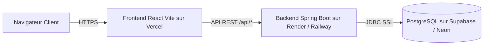

# Guide de Déploiement Gratuit Cloud – CareerTrack

Ce guide détaille la mise en production de **CareerTrack** sur des hébergeurs gratuits pour une soutenance ou une démonstration universitaire sans frais.

---

## Architecture de Déploiement Recommandée



---

## 1. Base de Données : PostgreSQL Gratuit (Neon.tech ou Supabase)

### Option A : Neon (Recommandé pour la rapidité)
1. Créez un compte gratuit sur [neon.tech](https://neon.tech).
2. Créez un projet nommé `careertrack-db`.
3. Récupérez la chaîne de connexion JDBC :
   ```
   jdbc:postgresql://ep-xyz.eu-central-1.aws.neon.tech/neondb?sslmode=require
   ```
4. Notez les identifiants :
   - `DB_HOST` = `ep-xyz.eu-central-1.aws.neon.tech`
   - `DB_NAME` = `neondb`
   - `DB_USER` = `votre_user`
   - `DB_PASSWORD` = `votre_password`

### Option B : Supabase
1. Créez un projet sur [supabase.com](https://supabase.com).
2. Dans **Settings > Database**, récupérez le mot de passe et l'URI direct de connexion avec SSL obligatoire.

> [!NOTE]
> **Stockage des documents & Quotas Cloud :**
> - Les pièces jointes des dossiers collaborateurs (CNI, diplômes, contrats) sont stockées directement dans la base de données PostgreSQL (table `employee_document_contents`, colonne `bytea`). Cela garantit qu'aucun document n'est perdu lors des redéploiements ou mises en veille du conteneur applicatif backend.
> - **Quotas d'hébergement gratuits :** Neon / Supabase proposent généralement entre 500 Mo et 1 Go de stockage gratuit (*valeur indicative à vérifier selon les conditions de chaque fournisseur*). Avec un plafond strict de 5 Mo par fichier pour une PME, ce volume est largement suffisant.
> - Sur Render Free, le système de fichiers local est éphémère (les disques persistants nécessitent un plan payant estimé à ~7 $/mois, *à vérifier*). L'approche en base de données permet de rester 100% gratuit et sans perte de données.

---

## 2. Backend : Spring Boot 3 sur Render ou Railway

### Déploiement sur Render.com (Plan Free)
1. Créez un compte sur [render.com](https://render.com).
2. Cliquez sur **New > Web Service**.
3. Connectez votre dépôt GitHub `CareerTrack`.
4. Configurez les paramètres :
   - **Name** : `careertrack-api`
   - **Root Directory** : `backend`
   - **Environment** : `Docker` (Render utilisera le fichier `backend/Dockerfile` multi-stage)
   - **Plan** : `Free`
5. Dans la section **Environment Variables**, renseignez les variables suivantes :

| Variable d'environnement | Valeur type | Description |
| :--- | :--- | :--- |
| `SPRING_PROFILES_ACTIVE` | `prod` (ou `prod,demo`) | `prod` pour production pure, `prod,demo` pour injecter les comptes et données de test |
| `DB_HOST` | `ep-xyz.neon.tech` | Hôte PostgreSQL cloud |
| `DB_PORT` | `5432` | Port par défaut |
| `DB_NAME` | `neondb` | Nom de la base |
| `DB_USER` | `votre_user` | Utilisateur PostgreSQL |
| `DB_PASSWORD` | `votre_mot_de_passe` | Mot de passe |
| `JWT_SECRET` | *(chaîne aléatoire 64 car)* | Clé de signature HMAC SHA-256 |
| `CORS_ALLOWED_ORIGINS` | `https://careertrack.vercel.app` | **Impératif en prod** : uniquement l'URL du frontend déployé (Vercel/Netlify), sans motifs localhost |
| `CAREERTRACK_LEAVE_DAYS_PER_MONTH` | `2.0` | 2 jours par mois effectif |
| `CAREERTRACK_MAX_CDD_MONTHS` | `24` | Plafond légal sénégalais |
| `CAREERTRACK_IPRES_RATE_EMPLOYEE` | `0.056` | 5,6% salarial |
| `CAREERTRACK_IPRES_RATE_EMPLOYER` | `0.084` | 8,4% patronal |
| `CAREERTRACK_CSS_RATE_EMPLOYER` | `0.070` | 7,0% allocations & AT |
| `MAIL_HOST` | `smtp.gmail.com` | Serveur SMTP Gmail |
| `MAIL_PORT` | `587` | Port TLS |
| `MAIL_USERNAME` | `votre-email@gmail.com` | Compte expéditeur |
| `MAIL_PASSWORD` | `votre-mot-de-passe-app` | Mot de passe d'application Google |
| `SWAGGER_ENABLED` | `false` (ou `true`) | Active Swagger UI et OpenAPI en production (`false` par défaut en profil `prod`, `true` en dev et demo). Requis si le jury souhaite consulter la documentation interactive de l'API. |

6. Cliquez sur **Create Web Service**. Au premier démarrage, **Flyway exécutera automatiquement** les migrations `V1__init_schema.sql` et `V2__reference_data.sql`.

---

## 3. Frontend : React Vite sur Vercel ou Netlify

### Déploiement sur Vercel (Recommandé)
1. Créez un compte sur [vercel.com](https://vercel.com).
2. Cliquez sur **Add New > Project** et importez le dépôt GitHub.
3. Configurez les options :
   - **Framework Preset** : `Vite`
   - **Root Directory** : `frontend`
   - **Build Command** : `npm run build`
   - **Output Directory** : `dist`
4. Ajoutez la redirection pour l'API et le Single Page Application :
   Dans le tableau de bord Vercel ou via `vercel.json` à la racine de `frontend/` :

```json
{
  "rewrites": [
    {
      "source": "/api/:path*",
      "destination": "https://careertrack-api.onrender.com/api/:path*"
    },
    {
      "source": "/(.*)",
      "destination": "/index.html"
    }
  ]
}
```

5. Cliquez sur **Deploy**. Votre frontend est immédiatement accessible via une URL HTTPS gratuite (ex: `https://careertrack.vercel.app`).

---

## 4. Profils de Déploiement : Production vs Démo

### Profil Démo Cloud (`SPRING_PROFILES_ACTIVE=prod,demo`)

> [!IMPORTANT]
> Le profil `demo` **ne contient pas la configuration de base de données** (datasource, JPA, Hikari). Il ne redéfinit que les emplacements Flyway.
> **Il doit donc toujours être combiné avec le profil `prod`** pour que la connexion PostgreSQL soit active :
> ```
> SPRING_PROFILES_ACTIVE=prod,demo
> ```
> Spring Boot fusionne les deux fichiers : `application-prod.yml` (datasource, JPA, JWT…) + `application-demo.yml` (Flyway → `db/migration` + `db/dev-migration`).

Pour une soutenance, une démonstration en direct ou un environnement de staging où vous souhaitez tester immédiatement l'interface avec des données réalistes :
- Le profil `demo` active [application-demo.yml](file:///home/diallo/for_me/Semestre_6/project/CareerTrack/backend/src/main/resources/application-demo.yml) qui surcharge les emplacements Flyway pour charger à la fois `db/migration` (V1, V2 – référentiel) et `db/dev-migration` (V3 – données de démonstration).
- Les 4 comptes de test sont automatiquement initialisés par la migration V3 :
  - **DRH** : `drh.ndiaye` / `password123`
  - **Manager N+1** : `mgr.sow` / `password123`
  - **Collaborateur** : `emp.diallo` / `password123`
  - **Direction** : `dir.fall` / `password123`

> [!WARNING]
> **Consigne de sécurité impérative :** Si vous déployez sur une URL publique accessible sur Internet avec le profil `demo`, **changez immédiatement les mots de passe par défaut** des comptes de démo via l'API ou mettez à jour leurs hachages BCrypt en base de données pour empêcher tout accès non autorisé.

---

## 5. Comptes Administrateurs & Initialisation Prod Pur (`SPRING_PROFILES_ACTIVE=prod`)

En production stricte (`application-prod.yml`), la migration Flyway charge uniquement `classpath:db/migration` :
- Les 4 rôles (`ROLE_DRH`, `ROLE_MANAGER`, `ROLE_EMPLOYE`, `ROLE_DIRECTION`).
- Les types de congés sénégalais légaux.
- Les paramètres réglementaires d'entreprise.

Pour créer votre premier compte DRH administrateur en production, connectez-vous à la console SQL Neon ou Supabase et insérez l'administrateur avec un mot de passe haché BCrypt personnalisé :

```sql
-- Création du compte DRH initial sécurisé
INSERT INTO users (id, username, email, password, enabled)
VALUES (
    gen_random_uuid(),
    'admin.drh',
    'drh@entreprise.sn',
    '$2a$10$vI8aWBnW3fID.ZQ4/zo1G.q1lRZh.PePdiGQ3t62zE3Yd14m91CGm', -- votre mot de passe
    true
);

-- Attribution du rôle DRH
INSERT INTO user_roles (user_id, role_id)
SELECT u.id, r.id FROM users u, roles r
WHERE u.username = 'admin.drh' AND r.name = 'ROLE_DRH';
```
