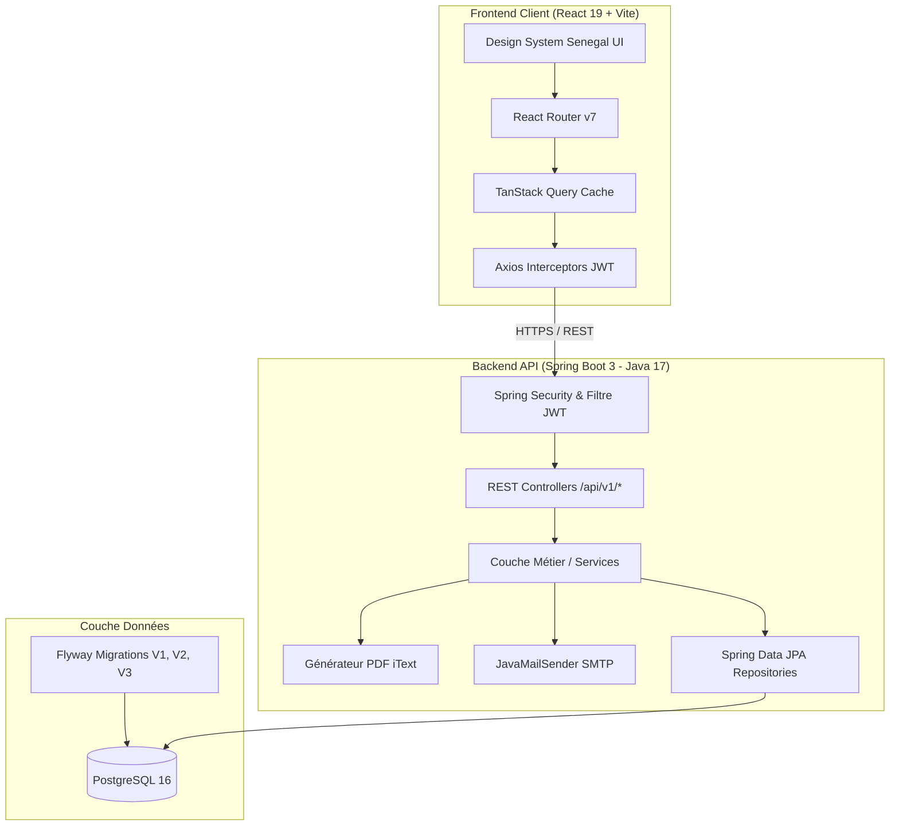
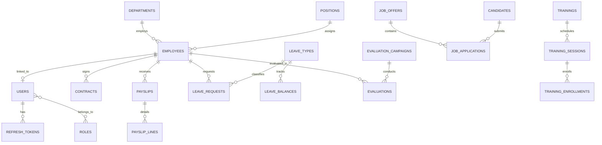
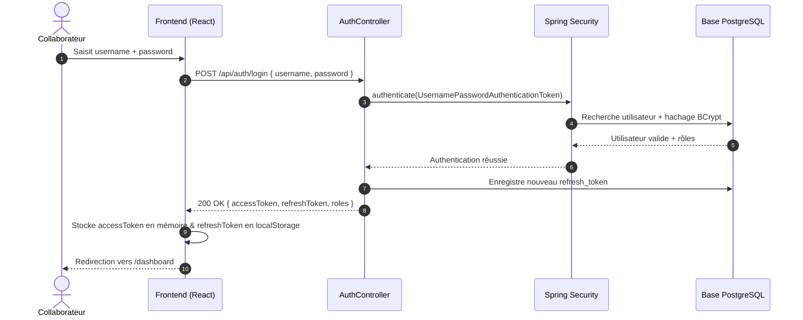
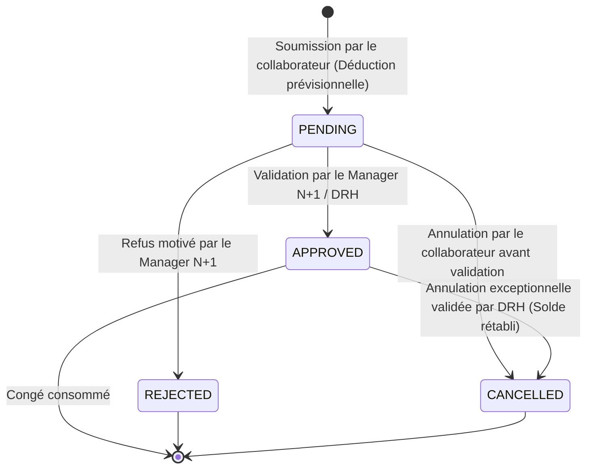

# Diagrammes UML & Spécifications d'Architecture – CareerTrack

Ce document contient les diagrammes d'architecture globale du système **CareerTrack**.
Les diagrammes de modélisation détaillée sont également consultables dans les documents dédiés :
- 📋 [Diagramme de Cas d'Utilisation](file:///home/diallo/for_me/Semestre_6/project/CareerTrack/docs/uml/use_cases.md)
- 🏗️ [Diagramme de Classes Métier](file:///home/diallo/for_me/Semestre_6/project/CareerTrack/docs/uml/class_diagram.md)
- 🔄 [Diagramme de Séquence du Processus d'Évaluation](file:///home/diallo/for_me/Semestre_6/project/CareerTrack/docs/uml/evaluation_sequence.md)

---

## 1. Diagramme de Composants & Architecture Globale

---

## 2. Schéma Entité-Association (ERD Simplifié)

---

## 3. Diagramme de Séquence : Authentification JWT & Refresh

---

## 4. Diagramme d'États : Cycle de Vie d'une Demande de Congé

