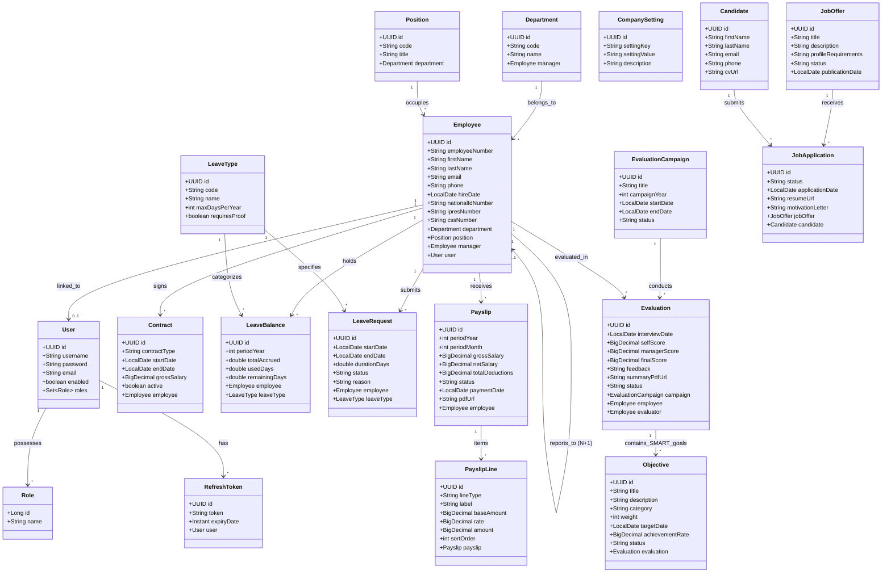

# Diagramme de Classes Métier – Système CareerTrack

Ce document décrit le modèle de domaine orienté objet de **CareerTrack**, avec les entités clés, leurs attributs, types et cardinalités.

---

## 1. Vue d'Ensemble du Domaine Métier

Le modèle métier s'articule autour de 10 sous-domaines :
1. **Sécurité & Utilisateurs** : `User`, `Role`, `RefreshToken`
2. **Organisation & Collaborateurs** : `Employee`, `Department`, `Position`, `Contract`
3. **Temps & Absences** : `LeaveRequest`, `LeaveType`, `LeaveBalance`
4. **Rémunération & Cotisations Sénégalaises** : `Payslip`, `PayslipLine`, `SalarySimulation`, `CompanySetting`
5. **Évaluations & Objectifs** : `EvaluationCampaign`, `Evaluation`, `Objective`
6. **Recrutement & Candidatures** : `JobOffer`, `JobApplication`, `Candidate`, `ApplicationInterview`
7. **Formations** : `Training`, `TrainingSession`, `TrainingEnrollment`
8. **Évolution & Carrière** : `PromotionProposal`
9. **Communication & Notifications** : `Notification`
10. **Documents** : `EmployeeDocument`

---

## 2. Diagramme de Classes (Mermaid)

