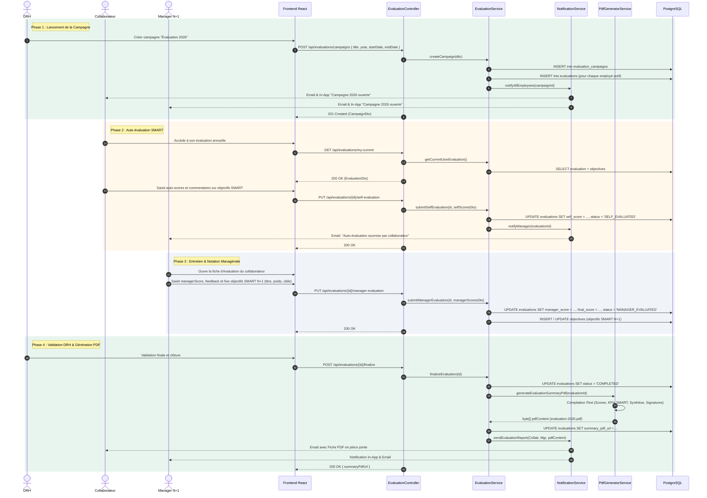

# Diagramme de Séquence – Processus d'Évaluation Annuelle

Ce document modélise le cycle complet du processus d'évaluation annuelle et de définition des objectifs SMART dans **CareerTrack**.

---

## 1. Description du Processus Métier

1. **Lancement de la campagne (DRH)** : La DRH crée la campagne annuelle (ex: `Campagne Annuelle 2026`) avec dates limites et critères. Les fiches d'évaluation individuelles sont automatiquement instanciées.
2. **Auto-évaluation (Collaborateur)** : Le collaborateur évalue l'atteinte de ses objectifs SMART de l'année N-1 (taux de complétion, auto-notation sur 5, commentaires) et soumet sa fiche.
3. **Entretien & Évaluation (Manager N+1)** : Le manager N+1 planifie l'entretien physique/virtuel, saisit ses notes, ajuste les scores, rédige sa synthèse et fixe les nouveaux objectifs SMART de l'année N+1 avec leurs pondérations.
4. **Validation conjointe & Clôture (DRH)** : Le collaborateur et le manager signent numériquement/valident la synthèse. La DRH valide définitivement l'évaluation, ce qui déclenche la génération automatique du rapport PDF officiel iText et l'archivage dans le dossier de l'employé.
5. **Impact RH** : Si les résultats dépassent les attentes, le manager peut déclencher une proposition de promotion ou d'augmentation salariale via le module Promotions.

---

## 2. Diagramme de Séquence (Mermaid)

