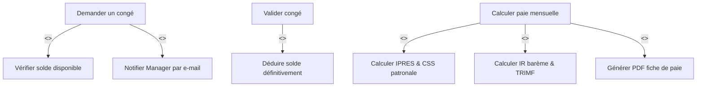

# Diagramme de Cas d'Utilisation – Système CareerTrack

Ce document présente les cas d'utilisation du système **CareerTrack** selon les différents profils d'acteurs de la PME sénégalaise.

---

## 1. Acteurs du Système

1. **Collaborateur (Employé)** : Salarié de l'entreprise ayant accès à son portail self-service (demandes de congés, consultation de fiches de paie, auto-évaluation SMART, catalogue de formations).
2. **Manager N+1** : Responsable d'équipe validant les demandes de congés, conduisant les entretiens annuels, proposant des promotions et participant au recrutement.
3. **DRH (Ressources Humaines)** : Gestionnaire principal (contrats, paie sénégalaise, campagnes d'évaluation, plans de formation, validation finale des congés, organigramme, paramétrages légaux).
4. **Direction Générale** : Consultation des tableaux de bord analytiques (masse salariale, turnover, absentéisme) et validation des simulations budgétaires.
5. **Candidat Externe** : Postulant aux offres d'emploi publiques.

---

## 2. Diagramme Global des Cas d'Utilisation

```mermaid
graph LR
    %% Acteurs
    Collab["Collaborateur"]
    Manager["Manager N+1"]
    DRH["DRH / Gestionnaire RH"]
    Dir["Direction Générale"]
    Candidat["Candidat Externe"]

    %% Sous-système Portail Collaborateur
    subgraph SelfService["Portail Collaborateur & Self-Service"]
        UC_LeaveReq["Demander un congé / absence"]
        UC_LeaveConsult["Consulter solde (2j/mois) & historique"]
        UC_Payslip["Télécharger fiches de paie (PDF)"]
        UC_SelfEval["Remplir auto-évaluation SMART"]
        UC_TrainingReq["Demander une inscription formation"]
        UC_DocConsult["Télécharger attestations RH (PDF)"]
    end

    %% Sous-système Management
    subgraph Management["Espace Manager N+1"]
        UC_LeaveApprove["Valider / Refuser congés de l'équipe"]
        UC_EvalConduct["Conduire entretien d'évaluation & noter"]
        UC_PromoPropose["Proposer promotion / augmentation"]
        UC_RecruitInterview["Participer aux entretiens de recrutement"]
    end

    %% Sous-système Administration RH
    subgraph AdminRH["Gestion & Pilotage RH (DRH)"]
        UC_EmpManage["Gérer dossiers employés & contrats"]
        UC_PayrollCalc["Calculer paie & cotisations (IPRES, CSS, IR, TRIMF)"]
        UC_PayrollPDF["Générer bulletins de paie certifiés (PDF)"]
        UC_CampaignLaunch["Lancer campagne d'évaluation annuelle"]
        UC_KanbanManage["Piloter recrutement (Kanban 6 étapes)"]
        UC_NotifyCandidate["Notifier candidats par e-mail automatique"]
        UC_TrainingPlan["Construire et suivre le plan de formation"]
        UC_OrgChart["Maintenir l'organigramme d'entreprise"]
        UC_CompanyParam["Configurer barèmes légaux sénégalais"]
    end

    %% Sous-système Direction
    subgraph Direction["Pilotage Stratégique"]
        UC_Dashboard["Consulter KPIs globaux & masse salariale"]
        UC_SimulateBudget["Simuler augmentations & impact financier"]
    end

    %% Sous-système Recrutement Externe
    subgraph PublicJob["Portail Recrutement"]
        UC_JobBrowse["Consulter offres d'emploi ouvertes"]
        UC_JobApply["Postuler en ligne (CV + LM)"]
    end

    %% Relations Collaborateur
    Collab --> UC_LeaveReq
    Collab --> UC_LeaveConsult
    Collab --> UC_Payslip
    Collab --> UC_SelfEval
    Collab --> UC_TrainingReq
    Collab --> UC_DocConsult

    %% Relations Manager
    Manager --> UC_LeaveApprove
    Manager --> UC_EvalConduct
    Manager --> UC_PromoPropose
    Manager --> UC_RecruitInterview
    Manager --|> Collab

    %% Relations DRH
    DRH --> UC_EmpManage
    DRH --> UC_PayrollCalc
    DRH --> UC_PayrollPDF
    DRH --> UC_CampaignLaunch
    DRH --> UC_KanbanManage
    DRH --> UC_NotifyCandidate
    DRH --> UC_TrainingPlan
    DRH --> UC_OrgChart
    DRH --> UC_CompanyParam
    DRH --|> Manager

    %% Relations Direction
    Dir --> UC_Dashboard
    Dir --> UC_SimulateBudget
    Dir --|> Collab

    %% Relations Candidat
    Candidat --> UC_JobBrowse
    Candidat --> UC_JobApply
```

---

## 3. Détail des Inclusions et Extensions (Include & Extend)

